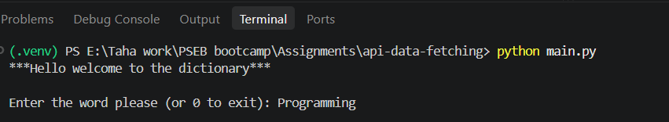
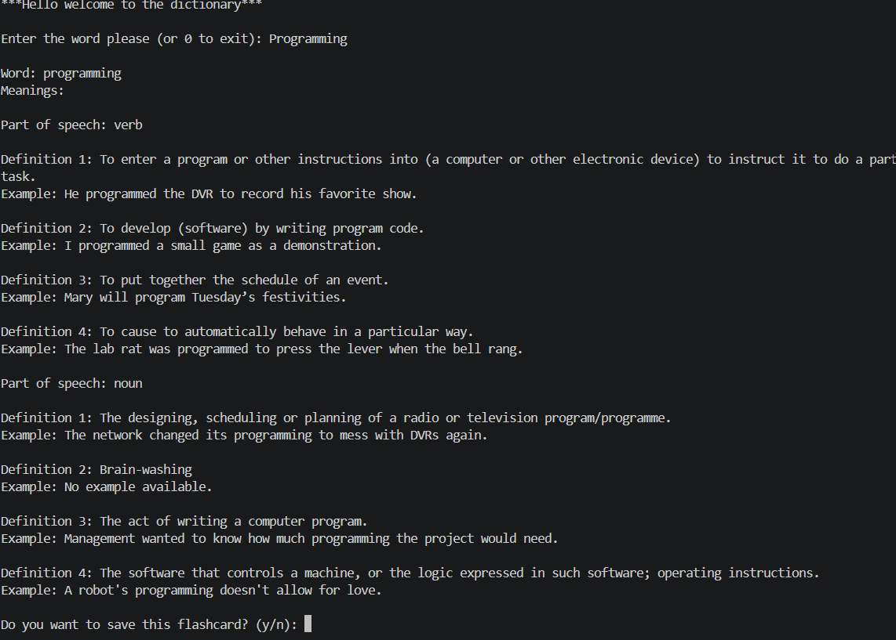
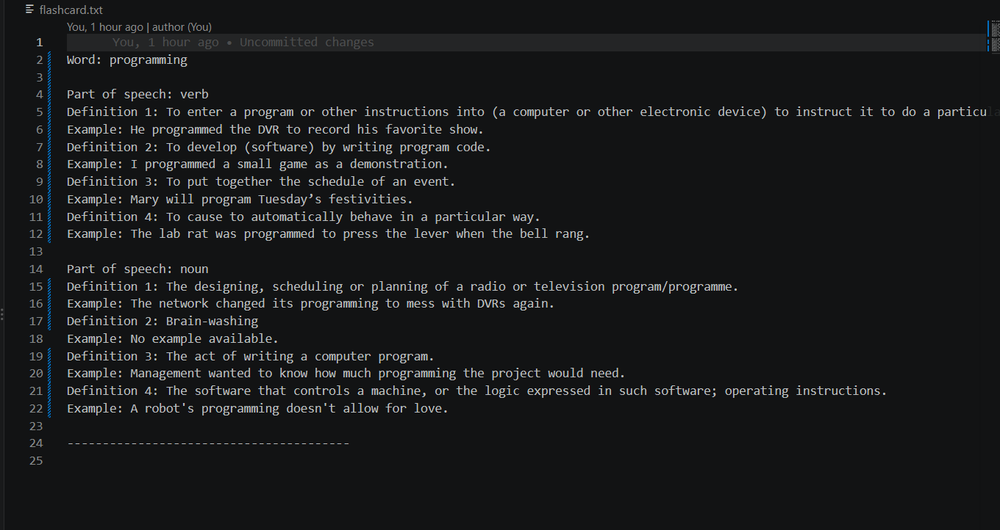
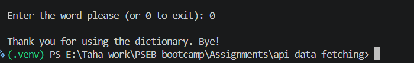

# Dictionary & Flashcard App 📖

A Python-based dictionary application that fetches live word information using the Free Dictionary API. Users can search for words, view their meanings, parts of speech, definitions and examples, and save useful information as flashcards.

## ✨ Features

- Search for English words.
- Fetch live dictionary data using an API.
- Display multiple meanings and parts of speech.
- Display definitions and available examples.
- Save words and their definitions to a text file.
- Search previously saved flashcards.
- Handle invalid words and network errors.
- Continue searching until the user chooses to exit.

## 🛠️ Technologies Used

- Python
- Requests library
- Free Dictionary API
- JSON
- File handling

## 📸 Application Screenshots

### Welcome Screen


### Word Search Results


### Flashcard Saved


### Existing Word Search



## 🌐 API Used

**Free Dictionary API**

API endpoint:

https://api.dictionaryapi.dev/api/v2/entries/en/{word}

The application sends an HTTP GET request to retrieve dictionary information in JSON format.

## ⚙️ Installation and Setup

### 1. Clone the repository

```bash
git clone https://github.com/Tahasdq/api-data-fetching
```

### 2. Navigate to the project folder

```bash
cd api-data-fetching
```

### 3. Create a virtual environment (recommended)

```bash
python -m venv .venv
```

Activate it:

Windows:
```bash
.venv\Scripts\activate
```

macOS/Linux:
```bash
source .venv/bin/activate
```

### 4. Install dependencies

```bash
pip install -r requirements.txt
```

### 5. Run the application

```bash
python main.py
```

## 📄 Requirements

The project requires:

```text
requests
```

## 💻 Sample Output

```text
***Hello welcome to the dictionary***

Enter the word please (or 0 to exit): hello

Word: hello
Meanings:

Part of speech: noun

Definition 1: An expression of greeting.
Example: Hello, how are you?

Do you want to save this flashcard? (y/n): y

Flashcard saved successfully!
```

*Sample output is illustrative. Your actual API response may contain more definitions and examples.*

## 📁 Project Structure

```text
dictionary-flashcard-app/
│
├── main.py
├── requirements.txt
├── README.md
├── .gitignore
└── screenshots/
    ├── result.png
    ├── start.png
    ├── storage.png
    └── terminate.png
```

## 🚀 Future Improvements

- Add the ability to view saved flashcards directly in the terminal.
- Add a feature to delete saved flashcards.
- Add vocabulary quizzes.
- Improve the user interface.
- Support additional languages.

## 👩‍💻 Author

Created as a Python API project.

## 📜 License

This project is intended for educational purposes.